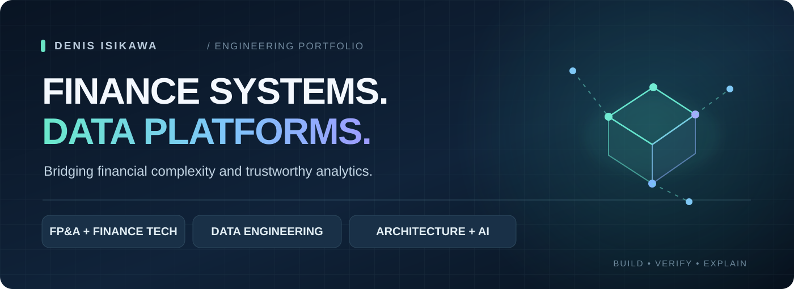
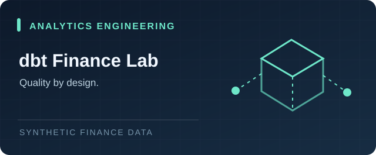
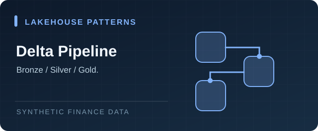
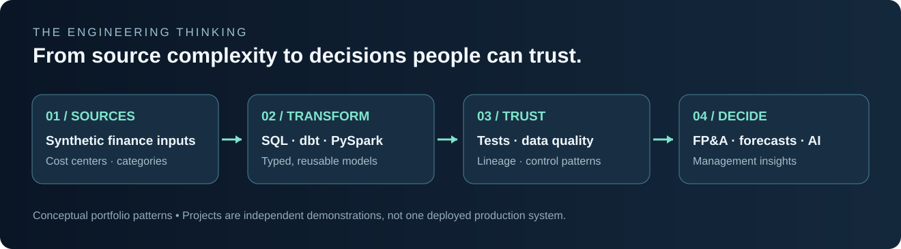
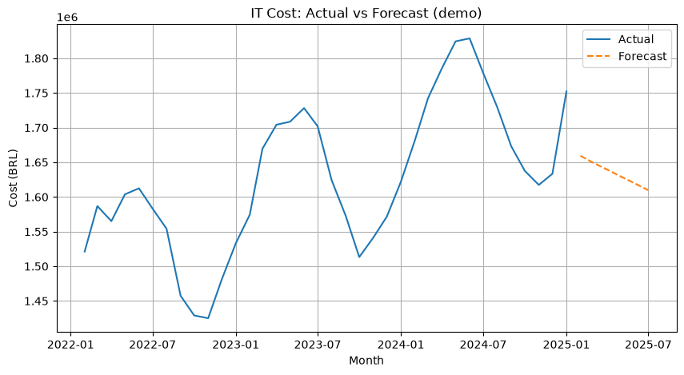
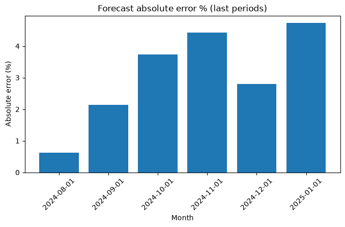

<div align="center">



<br/>

**FINANCE TECHNOLOGY · DATA ARCHITECTURE · ANALYTICS ENGINEERING**

I connect financial processes, data platforms and automation — turning complex inputs into reliable decision systems.

[**Explore the work ↓**](#featured-projects) &nbsp;·&nbsp; [**Architecture ↓**](#the-architecture-mindset) &nbsp;·&nbsp; [**Connect on LinkedIn ↗**](https://www.linkedin.com/in/denisisikawa)

<br/>

[](https://github.com/denisisikawa/denis-isikawa-databricks/actions/workflows/python-ci.yml)
[](https://github.com/denisisikawa/denis-isikawa-databricks/actions/workflows/dbt-finance-ci.yml)
[](#data-ethics--scope)

</div>

---

## Hi, I'm Denis.

**17+ years across finance, revenue systems, operations and data.** Currently a **Senior BI Analyst III** at Bradesco, working in the capacity of **FP&A Data & Analytics Technical Lead**, providing technical direction and cross-functional alignment for an **8-person team**.

I have built my career at the intersection of **financial controls and technology**: telecom billing and mediation systems, revenue assurance, management information systems, financial analytics, and end-to-end FP&A automation.

What interests me most is not a dashboard by itself. It's the system behind it: **trusted data, clear ownership, sound architecture and decisions people can defend.**

| Perspective | Where I focus |
| :-- | :-- |
| **Finance + Revenue** | FP&A, financial close, revenue assurance, billing, cost analysis |
| **Data platforms** | Databricks, PySpark, Python, SQL, Delta Lake patterns |
| **Analytics + automation** | Power BI, PowerApps, financial workflows and process controls |
| **Architecture + leadership** | Quality, governance, integration design, technical direction |
| **Learning in public** | dbt Analytics Engineering and Databricks certification preparation |

> **Career direction:** Finance Data Architecture · Finance Systems / EPM · Revenue Systems Transformation · Enterprise Analytics. I favor specialist and architecture-focused roles that combine technical depth with business outcomes.

---

## Featured projects

Four focused demonstrations. Each is intentionally built with **synthetic data** and designed to be reviewed without access to a private employer environment.

<table>
<tr>
<td width="50%" valign="top">
  <a href="dbt-finance-lab/README.md"></a>
  <h3>01 — Finance Analytics Engineering</h3>
  <p><b>dbt · DuckDB · SQL · data tests</b></p>
  <p>Models synthetic finance costs into a documented staging and monthly mart layer, with automated checks for grain, completeness and business constraints.</p>
  <p><b>Evidence:</b> reproducible local project + GitHub Actions dbt build.</p>
  <p><a href="dbt-finance-lab/README.md"><b>Explore project →</b></a></p>
</td>
<td width="50%" valign="top">
  <a href="databricks-pipeline-template/README.md"></a>
  <h3>02 — Lakehouse Finance Pipeline</h3>
  <p><b>Databricks · PySpark · Delta Lake</b></p>
  <p>A notebook-style example of Bronze / Silver / Gold patterns for ingesting, standardizing and aggregating IT-cost data.</p>
  <p><b>Scope:</b> reference architecture / demonstration, not a production deployment.</p>
  <p><a href="databricks-pipeline-template/README.md"><b>Explore project →</b></a></p>
</td>
</tr>
<tr>
<td width="50%" valign="top">
  <a href="fp-cost-forecast/README.md"></a>
  <h3>03 — Predictive Cost Forecasting</h3>
  <p><b>Python · pandas · scikit-learn</b></p>
  <p>Generates fictional monthly IT-cost histories and explores forecasts, validation and explainable reporting outputs for FP&A.</p>
  <p><b>Evidence:</b> executable local demo with tests and sample visuals.</p>
  <p><a href="fp-cost-forecast/README.md"><b>Explore project →</b></a></p>
</td>
<td width="50%" valign="top">
  <a href="ai-agent-fpa-query/README.md"></a>
  <h3>04 — AI-Assisted Finance Queries</h3>
  <p><b>Python · APIs · SQL · Genie patterns</b></p>
  <p>A self-service query handler exploring request validation, auditability and a synthetic offline fallback for finance analytics.</p>
  <p><b>Scope:</b> demonstration of integration patterns, not an autonomous production agent.</p>
  <p><a href="ai-agent-fpa-query/README.md"><b>Explore project →</b></a></p>
</td>
</tr>
</table>

---

## The architecture mindset



**My design principles**

- **Make data trustworthy before making it beautiful.** Validate assumptions, grain and lineage before publishing a metric.
- **Bridge the business and the platform.** Financial definitions should be translated into repeatable engineering rules.
- **Keep controls inspectable.** Tests, traceability and clear failure behavior matter as much as successful runs.
- **Favor reproducibility.** Synthetic data and explicit steps help others judge the work rather than the presentation.

---

## Proof of work

The portfolio is not just a collection of technology names. Every featured project has documentation, and the runnable components have reproducible instructions.

| Project | What to inspect | Execution |
| :-- | :-- | :-- |
| [dbt Finance Lab](dbt-finance-lab/README.md) | SQL models, YAML tests, synthetic seed, CI, [learning roadmap](dbt-finance-lab/CERTIFICATION_ROADMAP.md) | Local dbt + DuckDB |
| [Lakehouse Pipeline](databricks-pipeline-template/README.md) | Bronze / Silver / Gold notebook, transformation logic | Databricks-oriented template |
| [Cost Forecasting](fp-cost-forecast/README.md) | Forecast notebook, generated charts, Python tests | Local Python |
| [Finance Query AI](ai-agent-fpa-query/README.md) | API handler, safety checks, synthetic fallback | Local Python demo |

<details>
<summary><b>See sample forecasting outputs</b></summary>
<br/>
<table>
<tr>
<td width="50%"></td>
<td width="50%"></td>
</tr>
</table>
<sub>Illustrative charts from fictional input data. They do not represent a production forecast or employer performance.</sub>
</details>

---

## Reproduce the work

**Python projects**

```bash
python -m pip install -r requirements.txt
python -m pytest
```

- Windows: `./run_portfolio.ps1` from PowerShell
- macOS/Linux: `./run_portfolio.sh`

**dbt Finance Lab**

```bash
cd dbt-finance-lab
python -m pip install -r requirements-dbt.txt
# Copy profiles.example.yml to profiles.yml
dbt build --profiles-dir .
```

See each project's README for the full context, prerequisites and limitations.

---

## Currently sharpening

**dbt / Analytics Engineering:** SQL modeling, reusable transformations, test design, financial reconciliation and lineage.

**Databricks specialization:** strengthening Delta Lake, platform architecture and Unity Catalog concepts, with a [structured certification study plan](dbt-finance-lab/CERTIFICATION_ROADMAP.md). **No certification is claimed unless earned.**

---

## Data ethics & scope

This repository uses **fictional or synthetic data only**. Nothing here is a disclosure of Bradesco datasets, internal architecture, confidential controls or other proprietary material. Examples are independent learning and portfolio artifacts; they are not represented as a single live enterprise system.

---

<div align="center">

### Build systems people can trust.

**Finance systems × Data engineering × Decision intelligence**

[LinkedIn](https://www.linkedin.com/in/denisisikawa) &nbsp;·&nbsp; [GitHub Profile](https://github.com/denisisikawa) &nbsp;·&nbsp; [Explore the dbt Lab](dbt-finance-lab/README.md)

</div>
