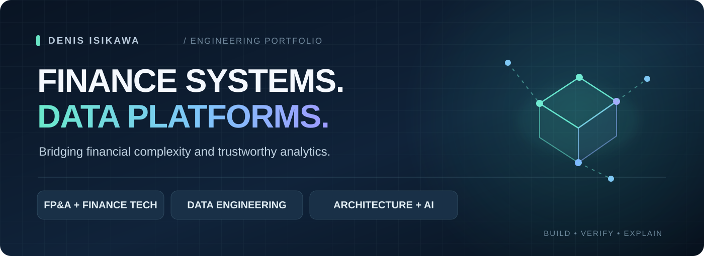
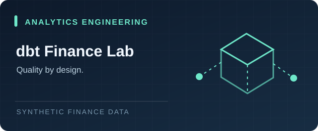
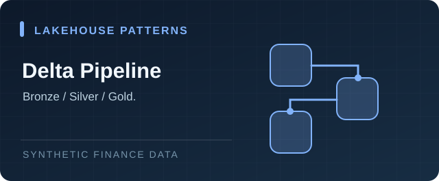

<!-- Copy this file into the root README.md of the public GitHub profile repository denisisikawa/denisisikawa. -->

 

**Finance Technology · Data Architecture · Analytics Engineering**

I connect finance, revenue systems and analytics to design reliable data platforms and automation.

[**Portfolio**](https://github.com/denisisikawa/denis-isikawa-databricks) &nbsp;·&nbsp; [**LinkedIn**](https://www.linkedin.com/in/denisisikawa)

---

### The short version

I work across **finance systems, data engineering, BI and enterprise automation**, with **17+ years** across financial and revenue processes. My formal role is Senior BI Analyst III at Bradesco; my work includes **technical leadership in FP&A Data & Analytics**, coordinating direction and cross-functional delivery with an 8-person team.

My focus is where technology makes financial information **more reliable, traceable and useful** — from billing and revenue assurance to data platforms, governance and decision support.

### Selected portfolio work

<table>
<tr>
<td width="50%" valign="top"><b>dbt Finance Lab</b> SQL transformations, synthetic FP&amp;A data marts, tests and CI. <a href="https://github.com/denisisikawa/denis-isikawa-databricks/tree/main/dbt-finance-lab">View project →</a></td>
<td width="50%" valign="top"><b>Databricks Pipeline Template</b> Bronze / Silver / Gold Delta patterns for finance analytics. <a href="https://github.com/denisisikawa/denis-isikawa-databricks/tree/main/databricks-pipeline-template">View project →</a></td>
</tr>
<tr>
<td width="50%" valign="top"><b>IT Cost Forecasting</b> Synthetic time-series modeling, validation and reporting. <a href="https://github.com/denisisikawa/denis-isikawa-databricks/tree/main/fp-cost-forecast">View project →</a></td>
<td width="50%" valign="top"><b>Finance Query AI</b> Controlled query-handling and a fictional offline fallback. <a href="https://github.com/denisisikawa/denis-isikawa-databricks/tree/main/ai-agent-fpa-query">View project →</a></td>
</tr>
</table>

### Where I bring value

`FP&A` · `Finance Systems` · `Revenue Assurance` · `Databricks` · `PySpark` · `Python` · `SQL` · `Power BI` · `Financial Data Architecture` · `Automation`

### Learning in public

**Now:** dbt Analytics Engineering, data quality / contracts, and structured Databricks certification preparation — without claiming unearned badges.

> All featured work uses synthetic data and is independent from employer production systems.

**Engineering clarity for complex financial data.**

[Explore the full portfolio](https://github.com/denisisikawa/denis-isikawa-databricks) · [Let's connect](https://www.linkedin.com/in/denisisikawa)

